  

  
  
  
  

<h2 align="center">Ahmed Adel Fekry Abdelkader</h2>

<strong>Computer Engineering Student · Full-Stack Web Developer · Embedded Systems &amp; IoT</strong>

## About

I'm a Computer Engineering student at **Modern Academy for Engineering, Cairo**, building software and hardware systems that work together. My work is split between **full-stack web applications** and **embedded systems / IoT**: from data-driven business platforms and bilingual interfaces to microcontroller firmware, sensor integration and practical prototypes.

I focus on clean application structure, useful workflows, secure data access, dependable device communication and connecting software with real-world hardware. I'm also the **Founder & Technical Lead at Archai Solutions**.

## What I work on

| Full-Stack Web | Embedded Systems & IoT | Hardware & Integration |
|---|---|---|
| Business dashboards, SaaS platforms, e-commerce, admin panels, authentication, REST APIs and bilingual Arabic/English interfaces. | C/C++ firmware, AVR / ATmega32, Arduino, ESP32, ESP8266, sensors, actuators, automation and connected devices. | KiCad PCB design, circuit integration, UART / SPI / I2C, Bluetooth, Wi-Fi, 3D mechanical concepts and local device-to-app workflows. |

## Selected work

### Web platforms and software

- **Archai Hub** — bilingual project and team management platform with role-based access, tasks, progress tracking, file workflows and PostgreSQL Row Level Security. Built with Next.js, React, TypeScript and Supabase.
- **Archai Corporate Showcase** — responsive Arabic/English company website with RTL support, project storytelling and backend-ready content architecture.
- **Secure LMS Marketplace** — course platform architecture with Supabase authentication, role separation, database policies and private media storage using Cloudflare R2. In active development.
- **Arabic POS & Local Print Agent** — Arabic RTL point-of-sale workflow integrated with a Windows print agent for ESC/POS thermal printing.
- **NFC & QR Customer Capture** — configurable customer intake for multiple brands and branches, with stable QR/NFC links, branch-level records, filters and spreadsheet export.
- **Hazo Stor E-Commerce & Smart Robotics** — responsive e-commerce work alongside firmware for autonomous robotics and Bluetooth/Wi-Fi smart-home devices.
- **AI PC Build Recommender** — an evolving JavaScript tool for Egyptian-pound budgets, component compatibility and AI-assisted build suggestions.

### Embedded and hardware projects

- **Arduino & ESP32 Robotics** — line-following and obstacle-avoidance vehicles, Bluetooth-controlled car, smart-home automation and an ESP32 robot arm.
- **Piezoelectric Energy-Harvesting Tile** — prototype concept using an array of 30 piezoelectric crystals and power-conditioning circuits.
- **ATmega32 Development Board & ROV Assembly** — custom AVR development-board work with PCB design and a remotely operated submarine assembly.

### Public repositories

| Repository | Focus |
|---|---|
| [Quiz / Exam System](https://github.com/ahmed4k4/quiz) | PHP-based quiz and exam workflow with question and result handling. |
| [Quran Website](https://github.com/ahmed4k4/quran) | Web project for Quran reading and audio content. |
| [AI API](https://github.com/ahmed4k4/ai-api) | Python API and machine-learning experimentation with data files. |
| [Personal Portfolio](https://github.com/ahmed4k4/CV-Ahmed-Adel) | Personal website source and profile presentation. |
| [Portfolio Website](https://github.com/ahmed4k4/CV-Ahmed-Adel) | Personal website source and profile presentation. |

Some client-facing and in-progress systems are private, so their source code is not linked publicly. The portfolio contains the detailed project summaries that can be shared.

## Technology stack

**Languages**  

**Web and backend**  

**Embedded, IoT and hardware**  

**Protocols and tools**  
`UART` · `SPI` · `I2C` · `Bluetooth` · `Wi-Fi` · `Git` · `GitHub` · `VS Code` · `Arduino IDE` · `Vercel`

## Experience

- **Founder & Technical Lead — Archai Solutions** · Jul 2026 – Present  
  Technical direction and delivery across full-stack applications, embedded prototypes, PCB-oriented work and IoT concepts.
- **Freelance Web & Embedded Systems Developer** · 2024 – Present  
  Client websites, e-commerce workflows, management dashboards, microcontroller prototypes and hardware/software integration.

## Education and training

- **B.Sc. in Computer Engineering** — Modern Academy for Engineering, Cairo · 2022 – Present · Expected graduation: **2027**.
- **Integrated Embedded Systems Training** — Information Technology Institute (ITI): AVR, C programming, peripherals and driver fundamentals.
- **Artificial Intelligence Training** — AMIT Learning: machine-learning fundamentals and Python-based data work.

## GitHub activity

  

The profile workflow refreshes repository, commit, star, follower and language statistics from the public GitHub API. It runs daily after the profile repository is published.

## Contact

- **Email:** [Ahmad4k4@gmail.com](mailto:Ahmad4k4@gmail.com)
- **Portfolio:** [ahmed-4k4.web.app](https://ahmed-4k4.web.app)
- **GitHub:** [github.com/ahmed4k4](https://github.com/ahmed4k4)
- **LinkedIn:** [linkedin.com/in/ahmed-adel-4k4](https://www.linkedin.com/in/ahmed-adel-4k4)
- **Location:** Cairo, Egypt

---

Designed and maintained by Ahmed4k4 · Built around software, firmware and real-world engineering.

