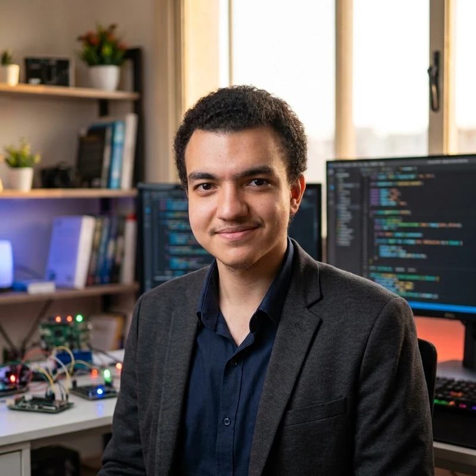
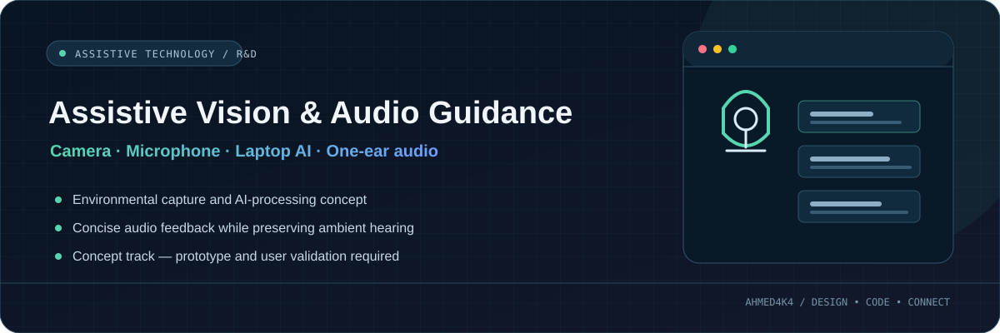

  <picture>
    <source media="(max-width: 640px)" srcset="assets/sm/banner.svg" />
    
  </picture>

  
  
  
  

<table>
  <tr>
    <td width="190" align="center" valign="middle">
      
    </td>
    <td valign="middle">
      <h2>Ahmed Adel Fekry Abdelkader · Ahmed4k4</h2>
      <strong>Computer Engineering Student · Full-Stack Web Developer · Embedded Systems &amp; IoT</strong> 
      Modern Academy for Engineering · Cairo, Egypt · Expected graduation: 2027  
      Software that connects to hardware. Systems engineered to solve practical problems.
    </td>
  </tr>
</table>

---

## Engineering profile

I work across two connected domains: **Web Engineering** and **Embedded Systems**. My software work focuses on bilingual business platforms, admin workspaces, secure learning systems, customer operations, attendance/time tracking and point-of-sale integrations. My hardware work focuses on C/C++ firmware, Arduino, AVR/ATmega32, ESP32, sensors, actuators, motor control, wireless connectivity, PCB-oriented hardware and robotics prototypes.

At **Archai Solutions**, I lead technical direction and implementation across web products, project/team operations and connected-system work. I also develop independent web and embedded projects.

نبذة بالعربي

أنا أحمد عادل فكري عبدالقادر، طالب هندسة حاسبات بالأكاديمية الحديثة للهندسة، ومؤسس ومسؤول تقني في Archai Solutions. أعمل على منصات ويب لإدارة الأعمال والمشروعات والفرق والتعليم والعملاء ونقاط البيع والحضور، وبالتوازي أطور أنظمة مدمجة باستخدام C/C++ وArduino وAVR وESP32، مع ربط الحساسات والمحركات والاتصالات والهاردوير. أركز على بناء أنظمة متكاملة تعمل فيها الواجهة وقاعدة البيانات والـFirmware والجهاز الفعلي معًا.

## 01 / Web platforms &amp; business systems

<picture><source media="(max-width: 640px)" srcset="assets/sm/work-archai-hub.svg" /></picture>

**Archai Hub — Project, Team &amp; Workforce Management** · Next.js, React, TypeScript, Supabase, PostgreSQL and RLS. Bilingual organisation/project workspace with Kanban, memberships, task ownership, resources, comments, activity and a substantial attendance module. Attendance covers fixed/flexible schedules, start/stop/resume sessions, server-recorded timestamps, late/early rules, day summaries, manager review and CSV reporting.

Repository: [ahmed4k4/wep_manger](https://github.com/ahmed4k4/wep_manger)

<picture><source media="(max-width: 640px)" srcset="assets/sm/work-attendance.svg" /></picture>

**Attendance &amp; Time Tracking** is presented as a core Archai Hub module, not a duplicate standalone project: fixed/flexible schedules, session control, server timestamps, reporting, exception review and monthly CSV summaries.

<picture><source media="(max-width: 640px)" srcset="assets/sm/work-lms.svg" /></picture>

**Secure LMS Marketplace** · Next.js 15, React 19, Supabase, PostgreSQL, RLS and Cloudflare R2. Multi-instructor roles, course/lesson management, quizzes, assignments, announcements, learner notes, lesson Q&amp;A, certificates and private media access using signed URLs. Payment processing is reserved for a later phase; R2 is storage, not DRM.

Repository: [ahmed4k4/secure-lms-marketplace](https://github.com/ahmed4k4/secure-lms-marketplace)

**Archai Solutions — Corporate Website &amp; 3D Experience** · Next.js 14, React, TypeScript, Tailwind CSS, Framer Motion, GSAP, React Three Fiber, Drei and Supabase. Bilingual Arabic RTL/English site with dark/light themes, animated service and case-study pages, reusable motion and page-specific WebGL scenes. Project documentation describes 14 reusable motion components and 10 3D scenes.

Repository: [ahmed4k4/archai-final-review](https://github.com/ahmed4k4/archai-final-review)

<picture><source media="(max-width: 640px)" srcset="assets/sm/work-pos.svg" /></picture>

**Arabic POS &amp; Windows Local Print Agent** · Next.js, TypeScript, Firebase, Firestore and ESC/POS. Arabic-first sales, customer and invoice workflows linked to 80 mm thermal printers through a Windows agent, local HTTP bridge and TCP ESC/POS output.

Repository: [ahmed4k4/wep_dash](https://github.com/ahmed4k4/wep_dash)

<picture><source media="(max-width: 640px)" srcset="assets/sm/work-nfc.svg" /></picture>

**Archai NFC — Multi-Brand Customer &amp; Branch Platform** · JavaScript, Firebase Auth, Firestore, QR/NFC and Excel. Stable public branch links, configurable forms, isolated branch records, temporary editing windows, customer details, pagination, date filters and multi-sheet Excel exports.

Repository: [ahmed4k4/archai-nfc-system](https://github.com/ahmed4k4/archai-nfc-system)

<picture><source media="(max-width: 640px)" srcset="assets/sm/work-pc-builder.svg" /></picture>

**AI-Assisted PC Build Recommender** · EGP budgets, component catalogues, compatibility checks, workload-aware AI recommendations, availability states and paginated manual selection. Active development; live offers depend on supplier data freshness.

<picture><source media="(max-width: 640px)" srcset="assets/sm/work-network-monitor.svg" /></picture>

**NetworkMonitor — Network Control &amp; Traffic Intelligence Center** · Python packet/flow processing with Scapy, FastAPI, WebSockets, PostgreSQL and a Next.js dashboard for device discovery, traffic, domains, protocols, alerts and device policies. **Active development:** flow attribution, traffic-direction classification and aggregation correctness remain under audit; it is not presented as production-verified.
Repository: [ahmed4k4/NetworkMonitor](https://github.com/ahmed4k4/NetworkMonitor)

**Hazo Stor — E-Commerce Platform** · Responsive storefront and product-discovery experience using HTML, CSS and JavaScript.

Additional software work: [Hazo Stor](https://github.com/ahmed4k4/Hazo_Stor) · [Python AI API](https://github.com/ahmed4k4/ai-api) · [Quiz](https://github.com/ahmed4k4/quiz) · [Quran](https://github.com/ahmed4k4/quran). The portfolio and CVs also itemise earlier chat, examination/quiz, CV/portfolio, Quran reading/audio, restaurant-site and storefront work as supporting projects, without presenting them as enterprise-scale products. An NFC hospital patient-profile/medical-history interface and PN532 URL writer are also classified as an early prototype, not as a production hospital platform.

## 02 / Embedded Systems, IoT &amp; Robotics

<picture><source media="(max-width: 640px)" srcset="assets/sm/work-smart-home.svg" /></picture>

**ESP32 Smart Home — Manual, Voice &amp; Intelligent Automation** · ESP32 firmware, Wi-Fi, sensors and relays. Three operating modes: direct manual switching, assistant-style voice-command input and sensor/rule-based automatic routines. No official Alexa integration is claimed.

<picture><source media="(max-width: 640px)" srcset="assets/sm/work-fire-fighting.svg" /></picture>

**Fire-Fighting Robot Car** · Mobile fire-response prototype combining flame-sensor feedback, differential-drive motor control and a separately controlled pump/extinguishing actuator.

<picture><source media="(max-width: 640px)" srcset="assets/sm/work-robotics.svg" /></picture>

**Interactive &amp; Autonomous Robotics** · Voice/gesture interaction prototype, PID line following, ultrasonic obstacle avoidance, Bluetooth phone control and a programmable servo arm. Related small vehicle experiments are consolidated into one robotics suite rather than inflated into multiple flagship projects.

**ATmega32 Development Board &amp; ROV Manipulator** · AVR/C, KiCad schematics and PCB routing, Fusion 360 and Blender mechanical modelling.

Repository: [ahmed4k4/AVR_Cproj](https://github.com/ahmed4k4/AVR_Cproj)

## Project status — accuracy first

| Status | Work represented |
|---|---|
| **Built / published** | Archai corporate experience, Archai NFC, Hazo Stor and selected earlier web applications. |
| **In development** | Archai Hub, Secure LMS, Arabic POS print integration, AI-assisted PC builder and NetworkMonitor. |
| **Prototype** | Smart home, fire-fighting robot, interactive robot, autonomous mobile robotics, robotic arm and ATmega32/ROV hardware. |
| **Research / planned** | UAV/drone, Edge-AI rover, ESP32-S3 AI voice terminal, assistive vision/audio and the advanced roadmap concepts. |

Research concepts are not presented as completed products. Voice control is assistant-style, not an official Alexa skill. Drone work is not flight-tested.

## 03 / Advanced Engineering Roadmap

<picture><source media="(max-width: 640px)" srcset="assets/sm/work-drone.svg" /></picture>

<picture><source media="(max-width: 640px)" srcset="assets/sm/work-esp32-voice.svg" /></picture>

<picture><source media="(max-width: 640px)" srcset="assets/sm/work-assistive.svg" /></picture>

The **14 advanced proposals** include UAV autopilot and ground station, Edge-AI rover, IIoT predictive maintenance, smart energy monitor, warehouse AGV, industrial IoT gateway/Mini-SCADA, read-only CAN/OBD-II logger, offline RFID attendance terminal, smart greenhouse, Edge-AI inspection, portable multi-protocol analyser, ROS 2 robot-fleet supervisor, ESP32-S3 AI voice terminal and assistive vision/audio device.

Full architecture, technical challenges, milestones, safety constraints and expected deliverables: **[PROJECT_ROADMAP.md](PROJECT_ROADMAP.md)**. These are proposals, not completed work.

## Engineering toolkit

- **Programming:** C, C++, JavaScript, TypeScript, Python, PHP.
- **Web:** HTML5, CSS3, React, Next.js App Router, Tailwind CSS, next-intl, GSAP, Framer Motion, React Three Fiber, responsive UI, Arabic RTL and technical SEO.
- **Backend &amp; data:** Node.js, Firebase Auth, Firestore, Supabase, PostgreSQL, MySQL, RLS, REST APIs and Cloudflare R2 signed access.
- **Embedded &amp; IoT:** Arduino, AVR/ATmega32, ESP32/ESP32-S3/ESP8266, GPIO, timers, ADC, PWM, firmware drivers, sensors, actuators and motor control.
- **Connectivity:** UART, SPI, I2C, serial communication, Wi-Fi and Bluetooth.
- **Hardware &amp; tools:** KiCad, PCB schematic/layout, Fusion 360, Blender, 3ds Max, ESC/POS, Git, GitHub, VS Code and Arduino IDE.

<picture><source media="(max-width: 640px)" srcset="assets/sm/stack.svg" /></picture>

## Experience, education &amp; training

<picture><source media="(max-width: 640px)" srcset="assets/sm/experience.svg" /></picture>

- **Founder &amp; Technical Lead — Archai Solutions** · Jul 2026–Present.
- **Freelance Web &amp; Embedded Systems Developer** · 2024–Present.
- **B.Sc. Computer Engineering — Modern Academy for Engineering, Cairo** · 2022–Present; expected graduation 2027.
- **DEPI — Digital Egypt Pioneers Initiative:** Front-End Development learning track.
- **ITI:** Embedded Systems training covering AVR, C, timers, ADC, UART, SPI, I2C and driver fundamentals.
- **AMIT Learning:** Artificial Intelligence training covering machine-learning fundamentals and Python data libraries.

Arabic: Native · English: Intermediate. Training tracks are not described as issued certificates unless a certificate is separately available.

## GitHub activity

<picture><source media="(max-width: 640px)" srcset="assets/sm/github.svg" /></picture>

Metrics are refreshed daily by the included GitHub Actions workflow using public GitHub account data. The recent comment figure counts `IssueCommentEvent` records in the latest public activity events returned by GitHub (up to 300 events); it is not a lifetime comment total.

## Contact

<picture><source media="(max-width: 640px)" srcset="assets/sm/contact.svg" /></picture>

  <a href="mailto:Ahmad4k4@gmail.com">Email</a> ·
  <a href="https://www.linkedin.com/in/ahmed-adel-4k4">LinkedIn</a> ·
  <a href="https://ahmed-4k4.web.app">Portfolio</a> ·
  <a href="https://github.com/ahmed4k4">GitHub</a>

<b>Build · Innovate · Automate</b> Designed and maintained by Ahmed4k4

SVG artwork includes embedded font subsets; the applicable SIL Open Font License notice is in <a href="assets/FONT-LICENSE-OFL.txt">FONT-LICENSE-OFL.txt</a>.
