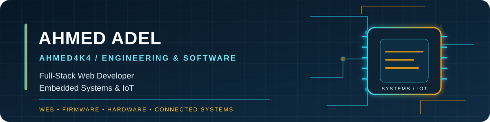
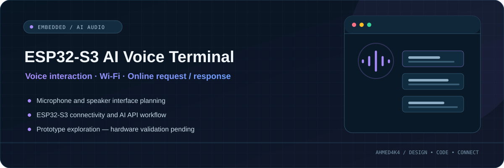

  <picture>
    <source media="(max-width: 640px)" srcset="assets/sm/banner.svg" />
    
  </picture>

  
  
  
  

  
  <h2>Ahmed Adel Fekry Abdelkader · Ahmed4k4</h2>
  <b>Computer Engineering Student · Full-Stack Web Developer · Embedded Systems &amp; IoT</b>
   Modern Academy for Engineering · Cairo, Egypt · Expected graduation 2027

---

## About

I build practical products across software and hardware: bilingual web platforms, business-management systems, embedded firmware, connected devices and robotics prototypes. My work spans product architecture, responsive interfaces, authentication and data access, database design, microcontroller programming, sensors, motor control and software–hardware integration.

**Current focus:** product-grade Next.js platforms and secure data workflows; C/C++ firmware, Arduino/AVR/ESP32, sensor integration, motor control, connected-device automation and practical software-to-hardware integration.

نبذة بالعربي

أنا أحمد عادل فكري عبدالقادر، طالب هندسة حاسبات ومطور ويب وأنظمة مدمجة. بشتغل على منصات ويب ثنائية اللغة وأنظمة إدارة الأعمال، وبطور نماذج Embedded وIoT باستخدام C/C++ وArduino وESP32، بالإضافة إلى مشروعات الروبوتات والتحكم وتصميم الدوائر.

**مجالات التركيز:** Next.js وReact، Firebase وSupabase، Arduino وESP32، إنترنت الأشياء، الروبوتات وتصميم PCB.

 

## Selected work

### Web platforms & business systems

<picture><source media="(max-width: 640px)" srcset="assets/sm/work-archai-hub.svg" /></picture>

<picture><source media="(max-width: 640px)" srcset="assets/sm/work-lms.svg" /></picture>

<picture><source media="(max-width: 640px)" srcset="assets/sm/work-pos.svg" /></picture>

<picture><source media="(max-width: 640px)" srcset="assets/sm/work-nfc.svg" /></picture>

<picture><source media="(max-width: 640px)" srcset="assets/sm/work-attendance.svg" /></picture>

<picture><source media="(max-width: 640px)" srcset="assets/sm/work-pc-builder.svg" /></picture>

### Embedded systems, IoT & robotics

<picture><source media="(max-width: 640px)" srcset="assets/sm/work-smart-home.svg" /></picture>

<picture><source media="(max-width: 640px)" srcset="assets/sm/work-fire-fighting.svg" /></picture>

<picture><source media="(max-width: 640px)" srcset="assets/sm/work-robotics.svg" /></picture>

<picture><source media="(max-width: 640px)" srcset="assets/sm/work-drone.svg" /></picture>

<picture><source media="(max-width: 640px)" srcset="assets/sm/work-esp32-voice.svg" /></picture>

<picture><source media="(max-width: 640px)" srcset="assets/sm/work-assistive.svg" /></picture>

**Other projects:** PID line follower, obstacle-avoidance car, Bluetooth-controlled robot car, programmable robotic arm, ATmega32 development board, ROV manipulator assembly, Hazo Stor e-commerce, online exams and quizzes, real-time chat, CV builder, Quran website, restaurant website and Python machine-learning API.

> Some business platforms and client-oriented implementations are private. The UAV/drone item, ESP32-S3 voice terminal and assistive vision/audio system are research or prototype-exploration tracks, not claims of completed production devices. Smart-home voice control is described as assistant-style interaction; it is not presented as an official Alexa integration.

## Engineering toolkit

- **Web engineering:** JavaScript · TypeScript · React · Next.js App Router · HTML5 · CSS3 · Tailwind CSS · Node.js · next-intl · GSAP.
- **Backend and data:** Firebase · Cloud Firestore · Firebase Authentication · Supabase · PostgreSQL · Supabase Auth · Row Level Security · MySQL · REST APIs · Cloudflare R2.
- **Embedded and IoT:** C · C++ · Arduino · AVR / ATmega32 · ESP32 / ESP32-S3 · ESP8266 · sensors · actuators · MPU6050 · BTS7960 · servo/PWM · IR and ultrasonic sensing · Wi-Fi · Bluetooth.
- **Hardware and integration:** KiCad · PCB schematics/layout · Fusion 360 · UART · SPI · I2C · ESC/POS thermal printing · local Windows print-agent integration · signed media URLs and HLS workflows.

## Technology stack

<picture><source media="(max-width: 640px)" srcset="assets/sm/stack.svg" /></picture>

**Hardware &amp; protocols:** KiCad · PCB schematic/layout · UART · SPI · I2C · PWM · Wi-Fi · Bluetooth · Sensors · Actuators · Motor drivers.

## Experience & education

<picture><source media="(max-width: 640px)" srcset="assets/sm/experience.svg" /></picture>

- **Founder &amp; Technical Lead — Archai Solutions** · Jul 2026–Present.
- **Freelance Web &amp; Embedded Systems Developer** · 2024–Present.
- **B.Sc. Computer Engineering — Modern Academy for Engineering, Cairo** · 2022–Present; expected graduation 2027.
- **DEPI — Digital Egypt Pioneers Initiative:** Front-End Development learning track.
- **ITI:** Embedded Systems training — AVR, C, timers, ADC, UART, SPI, I2C and driver fundamentals.
- **AMIT Learning:** Artificial Intelligence training — machine-learning fundamentals and Python data libraries.

These are learning and training tracks; they are not presented as certifications unless a certificate is separately issued.

## GitHub activity

<picture><source media="(max-width: 640px)" srcset="assets/sm/github.svg" /></picture>

Repository metrics are generated from the GitHub public API by the included GitHub Actions workflow. Language breakdown counts each repository's primary language, not source-code bytes.

## Get in touch

<picture><source media="(max-width: 640px)" srcset="assets/sm/contact.svg" /></picture>

- **Email:** [Ahmad4k4@gmail.com](mailto:Ahmad4k4@gmail.com)
- **Portfolio:** [ahmed-4k4.web.app](https://ahmed-4k4.web.app)
- **GitHub:** [@ahmed4k4](https://github.com/ahmed4k4)
- **LinkedIn:** [Ahmed Adel](https://www.linkedin.com/in/ahmed-adel-4k4)
- **Location:** Cairo, Egypt

  <b>Build · Innovate · Automate</b> 
  Designed and maintained by Ahmed4k4

---

Typography in the self-contained SVG artwork uses embedded font subsets. The corresponding SIL Open Font License notice is included at [`assets/FONT-LICENSE-OFL.txt`](assets/FONT-LICENSE-OFL.txt).
